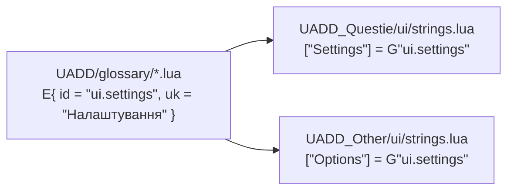

# The word base (glossary)

Many addons use the same words. "Settings", "Quest", "Close". We want them to read the same in Ukrainian in every
module. So the words live in one place: the word base. Modules point at it. They do not copy the Ukrainian.

The base is sorted by **meaning**, not by English text. One English word can mean two things. Then it gets two
entries, with two ids.



## Where things are

- `UADD/Glossary.lua` – the code. It loads first, before every module.
- `UADD/glossary/*.lua` – the words, one line per meaning:
  - `ui.lua` – buttons, menus, settings, profiles, the minimap button.
  - `game.lua` – game words: quest, NPC, zone, level, classes, races.
  - `quests.lua` – quest states, quest tags, quest messages, tracker actions.
  - `professions.lua` – professions, trainers, ranks, weapon skills.
  - `world.lua` – town NPCs, vendor types, holidays, auction house words (lot, bid, buyout, undercut, stack).
  - `journal.lua` – Dungeon Journal words: loot filters, item stats, gear slots, favourites.
  - `map.lua` – map pins, waypoints, zoom, floors, TomTom's arrow and coordinates.
  - `rares.lua` – RareScanner: rares, treasures, the explorer, collections, its filters.
  - `gear.lua` – Pawn: scales, stat weights, upgrades, gems and sockets, more item stats.
- `tools/glossary.py` – the checker.

## One entry

```lua
E{ id = "ui.close", en = "Close", uk = "Закрити", note = "Button: close a window." }
E{ id = "ui.settings", en = { "Settings", "Options" }, uk = "Налаштування", note = "The addon's settings menu." }
```

- `id` – a name for the meaning: `area.name`, lower case, `_` between words. Never change it once a module uses it.
- `en` – the English text. A list when several wordings mean exactly the same thing.
- `uk` – the Ukrainian text. Exactly what the player sees.
- `note` – one short line: what it means and where it shows up. This is what keeps two meanings apart.

## Is it the same meaning?

Link two strings to one entry only when **all** of these are true:

1. The thing is the same. A quest you track is not a music track. A "Close" button is not "close" (near).
2. It sits in the same kind of place: a button, a heading, a setting name, a tag.
3. The Ukrainian form fits both. Ukrainian words change with gender and number. "Доступне" fits "завдання". It
   does not fit "предмет".
4. You looked at how the addon uses the string. Do not guess from the English alone.

If one is false, make a second entry with its own id and a note that says how it differs.

Real cases from Questie (the two Layer rows: OpenMap and LayerSwap):

| English | Meaning | Entry |
| --- | --- | --- |
| Minimap Icons | quest marks drawn on the minimap | `map.minimap_pins` |
| Minimap Button | the addon's own button on the minimap | `ui.minimap_button` |
| Default | the name of the first profile ("Типовий") | `ui.profile_default` |
| default (value) | the value a setting has before you change it | not this entry |
| Legendary | a quest tag ("Легендарне") | `quest.tag_legendary` |
| Legendary | item quality ("Легендарний") | would be a new entry |
| Drink, Repair | what a vendor sells (nouns) | `vendor.drink`, `vendor.repair` |
| Layer | a drawn layer of the map, OpenMap ("Шар") | `map.layer` |
| Layer | a copy of the server's world, LayerSwap ("Лейер": the owner's word, 2026-11-18) | `game.server_layer` |
| Camping | UALL Forever's camp system, Mastercraft ("Табір": lead's choice, 2026-11-19) | `game.camping` |
| Camping | waiting at a spawn for a mob | not this entry («чатування» is banned in UADD_Mastercraft) |
| Lure | a fishing lure, Mastercraft ("приманка", never «принада») | `prof.lure` |
| Map Icons | marks an addon draws on the map, RareScanner's too ("Значки") | `map.map_pins` |
| Vignettes | the game's own map marks for rares and treasures ("Ігрові позначки") | `rare.vignettes` |
| Map pin | a pin the player drops, OpenMap ("Позначка") | `map.pin` |
| Repeatable | a quest tag ("Повторюване") | `quest.tag_repeatable` |
| Repeatable | a rare that comes back, RareScanner ("Що з'являється знову") | `rare.repeatable` |
| Scale | Pawn: a set of stat weights that values an item ("Шкала") | `gear.scale` |
| Scale | the size of a window or the UI (UALL's «Масштаб») | not this entry («масштаб» is banned in UADD_Pawn) |
| Node | GatherMate2: a spot to gather from, a herb, vein or fish pool ("Точка збору": lead's choice, 2026-11-20) | `prof.node` |
| Treasure | GatherMate2: a kind of node, chests ("Скарби") | `prof.node_treasure` |
| Nameplates | the name bars over units' heads ("Таблички імен", never «індикатор імені») | `game.nameplates` |

Long sentences stay in the module. The base is for short words and phrases that many places share.

## Add a word

1. Pick the file by topic. Add one line with `E{ ... }`. Fill in all four fields.
2. Prefer words that UALL already uses for game terms. Our own terms: завдання (quest), НІП (NPC), предмети
   (items), місця (zones).
3. Keep `%s`, `%d` and `|c...|r` codes the same in `en` and `uk`. The checker fails if they differ.
4. Run `python3 tools/glossary.py`. Then `python3 -m unittest discover -s tools`.

A new data file must be listed in `UADD/UADD.toc` after `Glossary.lua`, and added to git.

## Use the base in a module

At the top of the module's strings file:

```lua
local _, ns = ...
local G = UADD and UADD.Glossary and UADD.Glossary.Text or function() return nil end
ns.uiStrings = {
    ["Settings"] = G"ui.settings",            -- from the base
    ["Show quest levels"] = "Показувати рівень завдань", -- only this addon
}
```

The module's TOC must list `UADD` in `## Dependencies`, so the base loads first. In other code use
`UADD.Glossary.Text("ui.close")`. It gives the Ukrainian, or `nil` if the id is not there.

Before you write a new Ukrainian string, look in the base: `python3 tools/glossary.py --list`. If the meaning is
there, link it. If the meaning is new but other addons will need it too, add it to the base first.

## What the checker says

`python3 tools/glossary.py` (also run by `tools/check_repo.py` and the tests).

Fails (must fix):

- a module asks for an id that is not in the base;
- the same id twice;
- an entry without `id`, `en`, `uk` or `note`, or with a bad id;
- `%s`/`%d` or `|` codes that differ between English and Ukrainian.

Warns (look, then decide):

- the same English has different Ukrainian in two places, and one of them is a module string with its own
  Ukrainian. Link it if the meaning is in the base. If not, add a second entry and link that. Two entries with
  the same English (two meanings) do not warn, nor do module strings linked to them.
- a module string is exactly an entry, but not linked. Link it if the meaning is the same.
- a string is linked to an entry that does not list its English. Add the wording to `en`, or unlink.
