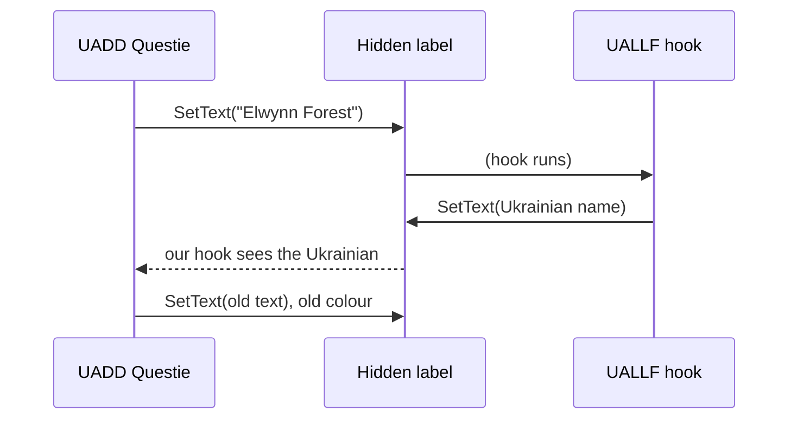

# Ukrainian names from UALL Forever: what we can read, and how

Checked against UALL Forever (UALLF) **1.0.18**. The addon is at
`C:\Program Files (x86)\World of Warcraft\_forever_\Interface\AddOns\UALLF\`.
Line numbers below were taken from 1.0.15 and may have moved a little.
A quest title that is also an item, NPC or UI text resolves to that, not to the quest (UALLF's
`StorageHooks.lua` asks UI texts, items, NPCs, then quest titles); seen with quest 91725, also an item in 1.0.18.
The code that uses this research is `UADD/uall.lua`.

## The short answer

| Kind | Route | Works in bulk? | Confidence |
|---|---|---|---|
| Zone | the hidden zone-name text (`ZoneTextString`) | yes | verified in code; speed needs an in-game test |
| NPC | the hidden title of the quest window (`QuestFrame`) | yes | verified in code |
| Item | the hidden name on a group-loot roll frame (`GroupLootFrame1..4`) | yes | verified in code; the frames need an in-game check |
| Quest title, by ID | none without borrowing the game's main tooltip | no | not possible safely |
| Quest title, by English title | the hidden title of a closed bag window | yes | verified in code; a small mix-up risk (see below) |

## Rules we kept

- We never copy UALLF's data, and we never write into its tables.
- We never edit UALLF's files.
- If UALLF has no translation, we return nothing and the caller keeps the English.
- We only borrow a piece of text while its window is hidden. We put its old text and colour back
  in the same call, so nothing is ever drawn.

## How the trick works

UALLF keeps all its translations in private tables, and it has no public function to look them
up. The only global names it creates are its slash command (`QuestHooks.lua:202-203`) and its
settings table, `UALLFSettingsDB` (`Settings.lua:251`).

UALLF does "hook" some of the game's text labels. That means: whenever the game writes English
into one of these labels, UALLF swaps in the Ukrainian inside the same call.

So for each lookup we:

1. pick a label that UALLF watches and whose window is hidden;
2. remember the label's text and colour;
3. write our English into it;
4. catch the Ukrainian that UALLF writes back (we watch the label's `SetText` too);
5. put the old text and colour back.

All five steps happen in one function call, so the screen never sees it.

### When UALLF will not answer

UALLF checks two things before it translates (`Settings.lua:293-304`, `ns.Active`):

- the kind's own setting is on (`Settings.lua:264-269`, `ns.IsEnabled`), and the main switch
  `enabled` is on;
- the "show original" key (Shift by default, `originalKey`) is **not** held. In reverse mode
  (`reverseOriginal`) the key works the other way and does not block us.

We read the same settings from `UALLFSettingsDB`. If the key is held, or we are in combat, or a
window we need is open, we return nothing **and do not remember the miss**, so the caller can
ask again later.

In reverse mode, UALLF writes the English straight back after the Ukrainian
(`Core.lua:76-99`). We read the value UALLF passes to `SetText`, so we still catch the
Ukrainian. Whether UADD should show Ukrainian to a player who picked reverse mode is UADD's
choice, not this file's.

### A check that the route really works

If UALLF did not hook a label (a different game build, a renamed frame), every lookup would
look like "no translation". To avoid saving thousands of false misses, each kind first tries
a few names we know UALLF has (for example "Elwynn Forest"). Until one of them comes back
Ukrainian, misses are not saved.

## Zone

- **Route:** `ZoneHooks.lua:23-41` (`Translate`). It looks the text up in `ns.zoneNames` by the
  exact English name. It pins `ZoneTextString`, `SubZoneTextString`, `PVPInfoTextString` and
  `PVPArenaTextString` (`ZoneHooks.lua:56-61`). This happens when the file loads (line 70), and
  again on `ADDON_LOADED` and `PLAYER_ENTERING_WORLD` (lines 72-79).
- **Setting:** `world.zones`, on by default (`Settings.lua:127`).
- **Bulk:** yes. One lookup is three `SetText` calls on a hidden label.
- **Risks:**
  - The labels belong to the big "you entered a zone" banner. While the banner is on screen we
    skip them. We use the next one, or return nothing.
  - UALLF remembers our test word as the label's "last pair" (`ns.Remember`, `Core.lua:93-99`).
    That only matters if someone holds Shift while the banner is up. The game always sets new
    text before it shows the banner, so the pair is fixed again then.
  - UALLF restores the text colour itself; we restore it too.
- **Not used:** the minimap (`MinimapZoneText`). It is only hooked if `world.minimap` is on, and
  that is off by default (`ZoneHooks.lua:65-68`, `Settings.lua:136`). The world map labels
  (`MapHooks.lua:27-29`) mix zone and interface words and are on screen while the map is open.
- **In-game test:** run `/uadd test`. Expect "zone: 10/10" or close. Then open Questie's
  tooltip for a quest in Elwynn Forest and check that the zone is in Ukrainian. Next, walk into
  a new zone and run `/uadd test` while the zone banner is still on screen. The banner must not
  flicker or change.

## NPC

- **Route:** `GossipHooks.lua:179-196` (`PinNpcTitle`). It looks the title text up in
  `ns.npcNames` by the exact English name. It does not split "Name &lt;Title&gt;". It is
  installed for `GossipFrame` and `QuestFrame` (`GossipHooks.lua:199-226`), when the player
  logs in or the first NPC window opens (`GossipHooks.lua:297`).
- **Setting:** `gossip`, on by default (`Settings.lua:71`).
- **Bulk:** yes.
- **Risks:**
  - We skip a window while it is open. Dialogue UI keeps both windows hidden all the time.
  - The pin only exists after login, so we do nothing before `IsLoggedIn()`.
- **Not used:**
  - Unit tooltips (`NpcHooks.lua:134-156`): they are limited to `GameTooltip` by name (line 137).
  - The target and focus frames (`NpcHooks.lua:217-237`): these are on screen.
- **In-game test:** `/uadd test` shows "npc: 7/8" or so ("Magni Bronzebeard" is not in UALLF's
  list). Then talk to a quest giver: the window title must still show that NPC's name.

## Item

- **Route:** `LootHooks.lua:22-39` (`ItemText`). It looks the text up in `ns.itemNames`, and in
  nothing else. It pins `GroupLootFrame1..4.Name` (`LootHooks.lua:62-86`). This happens when the
  file loads (line 92), and on `PLAYER_LOGIN` and `ADDON_LOADED` (lines 88-91).
- **Setting:** `interface.loot`, on by default (`Settings.lua:202`).
- **Bulk:** yes.
- **Risks:**
  - We start from roll frame 4 and skip any roll frame on screen.
  - If this game build has no `GroupLootFrame1..4`, the route is simply missing and we return
    nothing.
- **Not used:**
  - Item tooltips (`ItemHooks.lua:26`, checked at line 212): only `GameTooltip`, `ItemRefTooltip`
    and `ShoppingTooltip1/2` are translated. These are checked by name.
  - The loot window rows: they are pooled and only exist while it is open.
  - Lootified's table (`LootifiedHooks.lua:98-102`): Lootified is not installed.
- **In-game test:** `/uadd test` shows "item: 8/8". Check `/dump GroupLootFrame1 ~= nil` prints
  `true`. During a real group roll, the roll frame must show the right item.

## Quest title

### By quest ID: not possible safely

UALLF has `ns.GetQuest(id)` (`Core.lua:288-291`), but it is private. The only places that use it
for titles are tooltip handlers:

- `TrackerHooks.lua:295-334` (`LogTooltipUA`), run by the `EventRegistry` callback
  `"QuestMapLogTitleButton.OnEnter"` (line 336);
- `TrackerHooks.lua:347-393`, run by `"MapCanvas.QuestPin.OnEnter"` and
  `"TaskPOI.TooltipShown"` (line 396).

Both only work if the game's main `GameTooltip` belongs to the thing being hovered. To use them we
would have to:

- take over `GameTooltip`;
- fire a shared `EventRegistry` event that other addons and Blizzard code also listen to;
- let UALLF call `GameTooltip:Show()`.

That has visible side effects: other addons' tooltip hooks run, and the shared event fires
from our code. So we do not do it. The tracker and quest log labels (`TrackerHooks.lua:160-185`)
are pooled frames that only exist while on screen.

A hidden tooltip of our own does **not** work, because UALLF checks the tooltip's name.

### By English title: works

- **Route:** `StorageHooks.lua:20-43`. This is the title of a bag window (`ContainerFrameN`). It is
  pinned at file load, `PLAYER_LOGIN` and `ADDON_LOADED` (`StorageHooks.lua:57-85`). Bagnon is
  installed, so these Blizzard bag windows stay hidden.
- **Setting:** `interface.storage`, on by default (`Settings.lua:196`).
- **Bulk:** yes.
- **Risks:**
  - The lookup tries several lists in order: interface words, then item names, then NPC names, and
    quest titles last (`StorageHooks.lua:20-23`). A quest that has the same English name as an item
    or NPC gets that item's or NPC's Ukrainian. It is usually the same words.
  - Two quests with the same English title get the same Ukrainian, because UALLF's title list is
    keyed by English.
  - Any `$N`, `$B`, `$C`, `$R` or `$G...;` tokens are stripped, or filled in with the player's form.
  - If the caller gives only an ID, we ask the game for the English title
    (`C_QuestLog.GetTitleForQuestID`). That works without the quest being in the quest log, but
    only if the game has the quest cached.
- **In-game test:** `/uadd test` shows "quest: 7/8" ("Your Place In The World" is not in UALLF's
  title list). Open your bags: the bag title must still be right.
- **Spelling variants** (`QuestVariants.lua`): when the exact title misses, we ask again with a
  few other spellings: one space instead of two, small words like "in" and "the" in lower case,
  "Pastures'" as "Pastures", and "WANTED:" as "Wanted:", "Wanted -" or "Wanted!". The Ukrainian is
  still UALLF's own. A spelling that the item or NPC route also knows is not trusted, and neither
  is one we cannot check because that route is off or not answering (no waiting then). When two
  spellings give Ukrainian that differs only in letter case, marks, quotes or dashes, we take the
  one whose English is closest to ours; when the words differ, there is no answer. This finds 11 more quests (4746 → 4757 of
  5233), and each one matches UALLF's own by-ID title. `/uadd test` asks the exact title only, so
  it still says 7/8. The full list is in `research-quest-variants.md`.

## Things that are not routes

- UALLF creates no global function and exposes no mixin. Its `EventRegistry` callbacks
  (`MenuHooks.lua:129`, `TrackerHooks.lua:336`, `TrackerHooks.lua:396`) are only listened to,
  never offered.
- `ns.FvoTranslate` (`ForeverVOHooks.lua:429`) is private.
- Nameplates have their own setting, off by default, and draw on screen.
- UALLF has no names for game objects (chests, signs), so Questie objects stay English.

## Cost and limits for the caller

- **Out of combat only.** In combat, a new lookup returns nothing. Saved answers still come back.
- **Shift (the show-original key):** while it is held, new lookups return nothing. Do not run a
  bulk pass while the player holds it. Ask again later.
- **After login only.** The NPC route does not exist before `PLAYER_LOGIN`.
- **Cost per lookup:** three `SetText` calls on a hidden label, plus UALLF's table lookup. We
  expect a few microseconds each. `/uadd test` prints the real number. For thousands of names,
  split the work over several frames to be safe.
- **No quest log needed.** None of the routes read the quest log.
- **Caching:** answers and misses are saved for the session. They are cleared when a UALLF setting
  changes. A "not now" (combat, Shift, a window open, UALLF not ready) is never saved: the lookup
  returns `nil, true`, and the name collection asks the same name again a second later. After two
  minutes of "not now" it stops and tries the rest at the next login.
- **Taint:** we write into Blizzard labels from addon code, as UALLF already does. We only do
  this out of combat, and the game always writes fresh text before it shows these labels.

## Known limits

- **Quest titles that are also item or NPC names.** The bag route checks item and NPC names
  before quest titles (see "By English title"). 198 of the 3373 quest titles UALLF has are also an
  item or NPC name. For 20 of them UALLF's quest wording differs, and we get the item or NPC
  wording. We do not fix this: we have no route that asks for quest titles only.
- **Questie's quest list (tracker) stays English.** It shows the game's own quest titles and zone
  headers (`TrackerData.lua:129, 158-172`, `TrackerUtils.lua:565-575, 705-711`), not QuestieDB
  names. UALLF only translates Blizzard's own tracker. Our names show in Questie's map pins,
  tooltips and journey. The tracker font still switches to ours, so Ukrainian text there is not
  boxes.
- **The first login does not need a /reload.** Names are collected after Questie is ready. When
  the collection ends (and any fight is over), UADD asks Questie to drop its copies of the
  changed names and of every quest in the quest log, and to rebuild its quest log, map pins and
  tracker (`QuestieDB.RefreshAfterCorrectionApply`, `QuestieQuest:SmoothReset`). The chat says
  the names are shown only after that rebuild has finished. If Questie has not started within
  120 s, the rebuild takes more than 30 s, or something fails, the chat asks for a /reload instead.
  One thing stays English until the next login: the continent list in "My Journey", which Questie
  builds once (`QuestieJourney.lua:79-102`).

## Names that may be poor translations (open)

The owner flagged this on 2026-11-20. Some zone names in UALL Forever only spell out the English
sounds in Ukrainian letters (transliteration). They do not translate the meaning. Example: Razorfen
Downs is «Рейзорфен Даунс». Razorfen Kraul («Рейзорфен Краул») is built the same way.

We may need to do something about this later. For now we change nothing: game names still come from
UALL Forever (lesson 9). Any fix must change every place below at once, so one window never shows
two names for one place.

Where we show these names:

- **At runtime, from UALL Forever.** The name is looked up through `UADD.UALL.Zone`
  (`UADD/uall.lua`) by:
  - Attune (`UADD_Attune/Names.lua`);
  - Dungeon Journal: the page title and, from now on, the "NPC, zone" parts of quest details
    (`UADD_DungeonJournal/Names.lua`, `Content.lua`);
  - OpenMap (`UADD_OpenMap/Label.lua`);
  - Questie (`UADD_Questie/Names.lua`).
- **In sentences we wrote ourselves.** Attune's NPC notes (`UADD_Attune/ui/notes.lua`) contain the
  name as text:
  - Razorfen Kraul: `N2_4421` and `N2_4508`;
  - Razorfen Downs: `N2_7358` and `N2_12865`.

  These lines do not follow a change in UALL Forever: they must be edited by hand, in `ui/notes.lua`
  itself (`tools/make_att_text.py` reads them from there).

## ClassicUA

Every route here asks ClassicUA first and UALL Forever when ClassicUA has none (the owner, 2026-11-20;
`UADD/uall_cua.lua`, lesson 25). How ClassicUA is asked, and when not: `docs/research-classicua-names.md`.

## A note we could send to UALL's author

> Hi! We make UADD, a set of Ukrainian add-ons for WoW Forever, and we would like Questie's
> quest, NPC, item and zone names to match your translations exactly. We do not want to copy or
> ship your data. Right now we read your translations by writing English into hidden game labels
> that UALLF watches, which works but is fragile. Would you add a small public read-only lookup,
> for example `UALLF_Lookup(kind, englishText)` for "zone", "npc", "item" and "quest", plus
> `UALLF_GetQuestTitle(questID)`? Each would return your Ukrainian string or nil, with no side
> effects. We would credit UALL wherever these names show up. Thank you for the translation!
